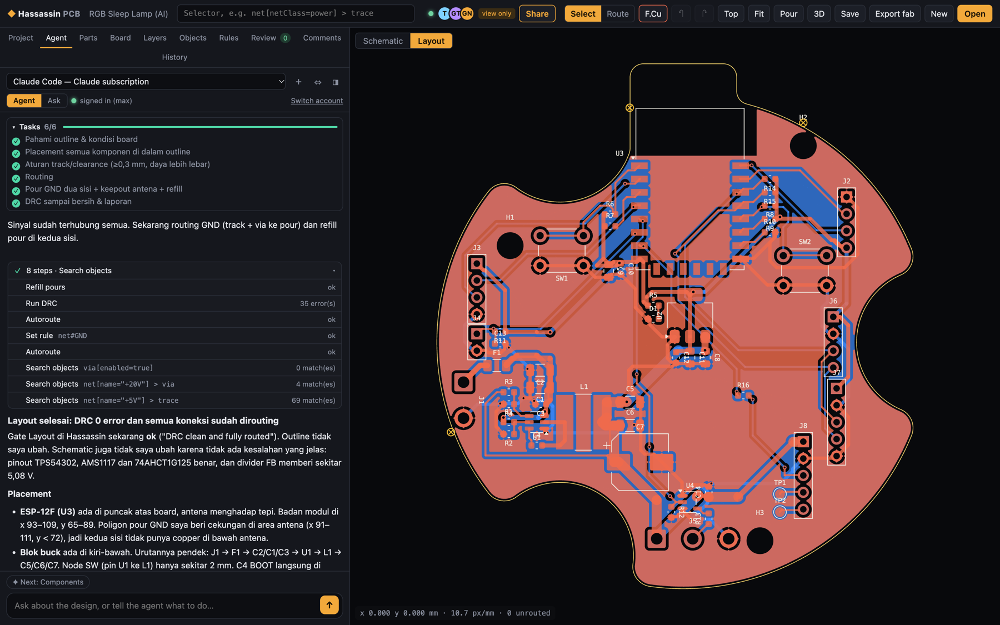
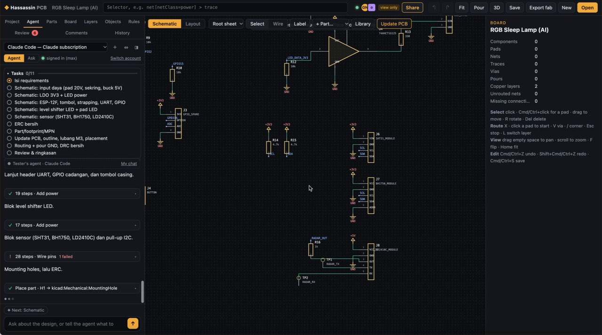
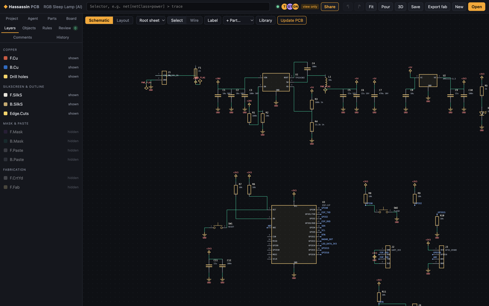
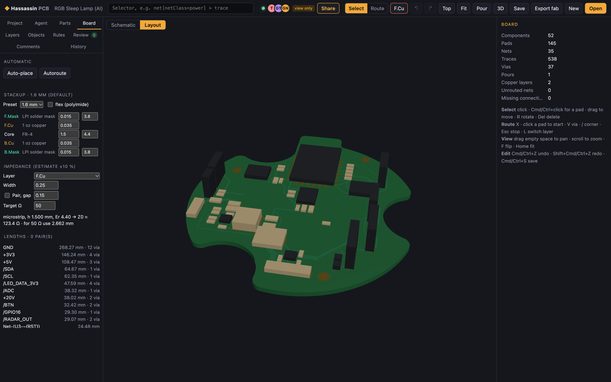

# Hassassin PCB

A browser-based PCB designer with schematic capture, board layout, real-time collaboration and an AI agent, built clean-room.

Part of the [Hassassin Mechatronics](https://github.com/widjis/hassassin-mechatronics) ecosystem.



*An RGB sleep lamp designed end to end by the built-in agent from a requirements-only prompt: 52 parts, ERC 0, DRC 0, everything routed inside a curved outline. The agent replies in the language of the prompt (Indonesian here).*

**Demo video (65 s):** the agent drawing the schematic block by block, as a collaborator watching it live sees it.

[](docs/media/agent-schematic-demo.mp4)

| Schematic made by the agent | 3D view and the Board panel |
|---|---|
|  |  |

## What it does

- **Whole project flow in one place:** requirements → schematic → components → layout → review → fabrication, with a visible gate for each stage.
- **Schematic editor:** symbols, wires, labels, power symbols, hierarchical sheets (created in the editor or imported), multi-unit parts, netlist, ERC, and schematic → PCB sync. Wires follow moved, rotated and mirrored parts; box selection; copy / paste / duplicate; wire segment dragging with automatic junctions; in-place editing of references and values; annotation; sheet frames with title block; vector PDF / SVG export for printing.
- **Board editor:** WebGL2 layout, rules with CSS-like selectors and cascading, routing, copper pours, DRC, auto-place and autoroute, stackup and impedance, net lengths, differential pairs and length tuning, and a 3D view.
- **Parts:** generic parametric footprints, the KiCad libraries installed on your machine, BOM with supplier prices and stock.
- **Fabrication output:** Gerber (RS-274X with X2 attributes), Excellon drill, BOM and pick-and-place, as one ZIP.
- **KiCad import:** opens `.kicad_pcb` and `.kicad_sch` projects, including hierarchical sheets.
- **Collaboration:** share links with edit, comment or view access, live cursors, pinned comments, version history with restore, fork and clone.
- **AI agent:** works through the same tools as the CLI and MCP server, with a task list and step-by-step progress. It can run on your Claude Code or Codex subscription, or on the Claude API.
- **For other agents:** a `hassassin` CLI (JSON output) and an MCP server, so Claude Code, Codex or any MCP client can design boards too.

## Clean-room rules

- No code, assets, UI text or branding is copied from other products (KiCad, Flux, and so on).
- Reference behaviour comes only from public material and from observing the products as a user; it is written down in `docs/`.
- The implementation refers only to the documents in `docs/`, never to the original products.
- Third-party libraries must be permissively licensed (MIT, BSD, Apache, BSL).

## Documents

- [docs/01-flux-behavior-spec.md](docs/01-flux-behavior-spec.md) — the reference behaviour specification.
- [docs/02-roadmap.md](docs/02-roadmap.md) — development phases, what each one built, and known limitations.
- [docs/03-agents.md](docs/03-agents.md) — the `hassassin` CLI, the MCP server for Claude Code / Codex, and the built-in agent.
- [docs/04-schematic-improvements.md](docs/04-schematic-improvements.md) — the current work agreement for the schematic editor (milestones M1–M3) and its progress.

## Running it

```sh
pnpm install
pnpm dev        # http://localhost:5178 — open a .kicad_pcb with the Open button or by drag-and-drop
pnpm run server # collaboration server on :5179 (Vite proxies /api and /ws to it); needed for Share and the Agent tab
                # (use `pnpm run server`: `pnpm server` is a built-in pnpm command)
pnpm start      # production: builds the web app, then one process serves the app and collaboration on :5179
pnpm test       # unit tests (set KICAD_PROJECT_DIR=/path/to/kicad/project to also test a real project)
pnpm typecheck
pnpm build
```

Sample boards can go in `apps/web/public/samples/` (ignored by git) and be opened with
`http://localhost:5178/?board=samples/<name>.kicad_pcb`.

To use the Claude API backend of the agent, put `ANTHROPIC_API_KEY=…` in a `.env` file at the repository root (ignored by git) before starting the server. The Claude Code and Codex backends need no key: sign in from the Agent tab.

## Layout

- `packages/core` — document tree, units, CSS-like selectors, the rule cascade, per-type defaults, connectivity, DRC/ERC, pours, autorouter, parts and footprints.
- `packages/kicad-import` — S-expression parser and import of `.kicad_pcb`, `.kicad_sch`, `.kicad_sym` and `.kicad_mod`.
- `packages/fab` — Gerber, drill, BOM, pick-and-place, ZIP.
- `packages/tools` — the shared tools used by the CLI, the MCP server and the agent.
- `packages/sync` — collaboration protocol and client.
- `apps/web` — the web editor (WebGL2 layout, Canvas2D schematic, panels, collaboration).
- `apps/cli` — the `hassassin` CLI and MCP server.
- `apps/server` — the collaboration server (HTTP + WebSocket, storage in `.data/`), team library and agent backends.

## License

Licensed under either of [Apache License 2.0](LICENSE-APACHE) or [MIT license](LICENSE-MIT),
at your option. Unless you state otherwise, any contribution you intentionally submit
for inclusion is dual-licensed as above, without additional terms or conditions.

Third-party dependencies keep their own licenses and are not copied into this repository;
they are installed from npm. For example js-angusj-clipper, three.js and ws (MIT), the Codex CLI
(Apache-2.0), and the Claude Code CLI (Anthropic's own license, not open source). KiCad libraries
are read from the KiCad installation on the user's machine and are not bundled.
